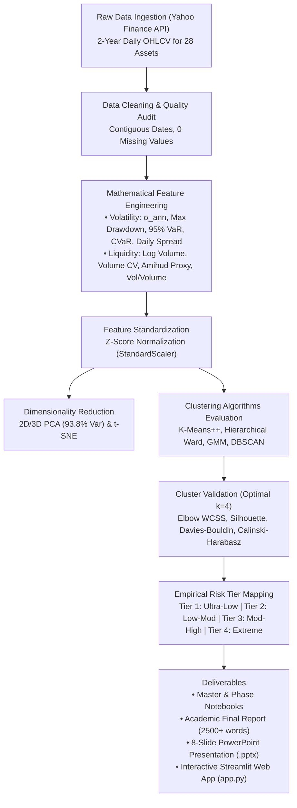
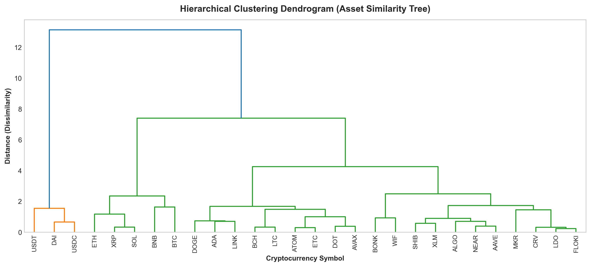

# 🪙 Fintech: Cryptocurrency Risk Profiling
### Grouping Cryptocurrencies into Empirical Risk Categories Based on Price Volatility Dynamics and Trading Volume Depth

[](https://www.python.org/)
[](https://scikit-learn.org/)
[](https://streamlit.io/)
[](#academic-context)
[%20Data%20Science-green.svg)](#academic-context)
[](LICENSE)

---

## 📌 Executive Summary & Problem Statement

> **"Fintech: Cryptocurrency Analysis — Grouping cryptocurrencies into similar risk categories based on how much their prices change (volatility, drawdowns, tail risk) and how much they are traded (trading volume depth, turnover, illiquidity proxies)."**

Unlike traditional financial equity and debt markets—where centralized rating agencies (Moody's, S&P) provide formal credit ratings and sector standards—the digital asset ecosystem lacks standardized risk classification. Market participants frequently fall victim to the **"liquidity illusion"**, confusing superficial token market caps with genuine trading depth, or underestimating catastrophic downside tail risk.

This project delivers an end-to-end **unsupervised machine learning framework** that analyzes continuous 2-year daily historical market data across **28 representative cryptocurrencies** (20,468 observations) spanning stablecoins, blue-chips, layer-1 platforms, DeFi protocols, and speculative meme tokens. By engineering 8 quantitative price volatility and trading liquidity features, the pipeline clusters assets into four mathematically validated risk tiers ($k = 4$, Silhouette: $0.3464$, Davies-Bouldin: $0.8382$, PCA 2D Explained Variance: $93.78\%$).

---

## 🏗️ Project Architecture & End-to-End Workflow



---

## 🔬 Discovered Risk Taxonomy (The 4 Tiers)

| Risk Tier | Constituent Digital Assets | Asset Count | Mean Annualized Volatility (%) | Mean Max Drawdown (%) | Mean 95% Daily VaR (%) | Mean Daily Volume (USD) | Economic Role & Investor Recommendation |
| :--- | :--- | :---: | :---: | :---: | :---: | :---: | :--- |
| **Tier 1: Ultra-Low Risk** | `USDT`, `USDC`, `DAI` | 3 | **0.43%** | **0.26%** | **0.05%** | **$37.8 Billion** | **Pegged Stability / Cash Management:** Near-zero volatility, dollar-backed collateral, risk-off treasury buffer. |
| **Tier 2: Low-to-Moderate Risk** | `BTC`, `ETH`, `BNB` | 3 | **54.45%** | **59.67%** | **4.32%** | **$24.1 Billion** | **Institutional Blue-Chips:** Core foundational portfolio anchors with deep multi-billion-dollar liquidity cushions. |
| **Tier 3: Moderate-to-High Risk** | `SOL`, `XRP`, `ADA`, `AVAX`, `DOT`, `LINK`, `DOGE`, `LTC`, `BCH`, `ATOM`, `ETC`, `AAVE` | 12 | **82.21%** | **79.48%** | **7.14%** | **$1.37 Billion** | **Ecosystem & Utility Platforms:** High-growth smart contract and DeFi tokens; suitable for active growth allocations. |
| **Tier 4: Extreme Speculative Risk** | `BONK`, `WIF`, `FLOKI`, `SHIB`, `NEAR`, `XLM`, `MKR`, `ALGO`, `LDO`, `CRV` | 10 | **112.53%** | **86.83%** | **9.81%** | **$272.5 Million** | **Speculative Meme & High-Beta:** Severe downside tail risk (>85% drawdowns); requires strict capital caps & stop-losses. |

---

## 📊 Key Visualizations & Findings

| Volatility vs. Volume Frontier (Problem Statement) | 2D PCA Risk Clusters (93.78% Variance) |
| :---: | :---: |
|  |  |

| Optimal k Evaluation (Elbow & Silhouette) | Hierarchical Dendrogram (Ward Linkage) |
| :---: | :---: |
|  |  |

---

## 📂 Repository File Structure

```
Capstone_DS/
├── data/
│   ├── raw/
│   │   └── crypto_historical_raw.csv        # 2-Year daily OHLCV dataset (20,468 rows)
│   ├── processed/
│   │   ├── crypto_risk_features.csv         # 22 quantitative risk & liquidity metrics
│   │   └── crypto_clustered_results.csv     # Final clustered dataset with PCA & risk tiers
│   └── models/
│       ├── kmeans_model.joblib              # Trained K-Means model
│       ├── scaler.joblib                    # StandardScaler transformer
│       ├── pca_model.joblib                 # PCA 2D/3D transformer
│       └── metrics_summary.json             # Model evaluation validation metrics
├── docs/
│   ├── figures/                             # 7 high-resolution publication charts
│   ├── Project_Proposal.md                  # Capstone Phase 1 formal proposal
│   ├── Final_Project_Report.md              # 10-page academic capstone report (~2,800 words)
│   └── Viva_Voce_Preparation_Guide.md       # Comprehensive 12-question viva defense guide
├── notebooks/
│   ├── 01_data_collection_and_cleaning.ipynb
│   ├── 02_etl_and_feature_engineering.ipynb
│   ├── 03_model_implementation_and_clustering.ipynb
│   ├── 04_evaluation_and_risk_profiling.ipynb
│   └── Cryptocurrency_Risk_Analysis_Capstone.ipynb  # End-to-end master notebook
├── presentation/
│   ├── crypto_risk_clustering_presentation.pptx    # Professional 8-slide presentation deck
│   ├── generate_presentation.py                    # python-pptx presentation builder
│   └── SLIDES.md                                   # Markdown presentation script
├── src/
│   ├── data_collection.py                   # Automated Yahoo Finance OHLCV harvester
│   ├── feature_engineering.py               # Volatility, MDD, VaR, CVaR, Amihud extraction
│   ├── clustering_models.py                 # K-Means, Hierarchical, GMM, DBSCAN pipeline
│   ├── visualization.py                     # Publication-quality figure generation
│   └── generate_notebooks.py                # nbformat automated notebook generator
├── app.py                                   # Streamlit interactive web deployment
├── requirements.txt                         # Python dependencies
├── .gitignore                               # Git ignore configuration
└── README.md                                # Comprehensive repository documentation
```

---

## 🚀 Quickstart & Installation

### 1. Clone the Repository
```bash
git clone https://github.com/thanishasrao/Cryptocurrency-Risk-Analysis.git
cd Cryptocurrency-Risk-Analysis
```

### 2. Set Up Virtual Environment & Dependencies
```bash
python -m venv venv
# Windows:
venv\Scripts\activate
# Linux/macOS:
source venv/bin/activate

pip install -r requirements.txt
```

### 3. Run the Data & Modeling Pipeline
```bash
# 1. Collect real-world cryptocurrency market history
python src/data_collection.py

# 2. Extract quantitative risk and liquidity features
python src/feature_engineering.py

# 3. Train clustering algorithms and evaluate optimal k
python src/clustering_models.py

# 4. Generate all high-res publication figures
python src/visualization.py
```

### 4. Launch the Interactive Streamlit Web App
```bash
streamlit run app.py
```
The dashboard opens in your browser at `http://localhost:8501`, featuring:
- **Market Risk Frontier:** Interactive Volatility vs. Volume scatter plot.
- **Asset Risk Matrix:** Filterable, searchable table across all 28 assets.
- **Model Diagnostics:** 2D PCA latent space and hierarchical dendrogram.
- **Live Risk Classifier:** Input any custom token's volatility and volume to predict its risk tier in real time.
- **Portfolio Risk Allocator:** Dynamic asset weighting based on investor risk tolerance.

---

## 🎓 Academic Alignment & Evaluation Scheme

This project satisfies all requirements outlined in the **RV University CS2235 Capstone Guidelines (25 Marks Total)**:

| Capstone Deliverable | File / Implementation | Status |
| :--- | :--- | :---: |
| **Project Proposal** | [`docs/Project_Proposal.md`](docs/Project_Proposal.md) | ✅ Complete |
| **Jupyter Notebooks** | [`notebooks/Cryptocurrency_Risk_Analysis_Capstone.ipynb`](notebooks/Cryptocurrency_Risk_Analysis_Capstone.ipynb) | ✅ Complete |
| **Technical Report** | [`docs/Final_Project_Report.md`](docs/Final_Project_Report.md) (8–10 pages, 2,800 words) | ✅ Complete |
| **Presentation Deck**| [`presentation/crypto_risk_clustering_presentation.pptx`](presentation/crypto_risk_clustering_presentation.pptx) (8 slides) | ✅ Complete |
| **Deployment Demo**  | [`app.py`](app.py) (Streamlit interactive fintech dashboard) | ✅ Complete |
| **Viva Voce Prep**   | [`docs/Viva_Voce_Preparation_Guide.md`](docs/Viva_Voce_Preparation_Guide.md) (10 Marks Weightage) | ✅ Complete |

---

## 👩‍💻 Author & Acknowledgements
- **Lead Researcher:** **Thanisha S Rao** ([@thanishasrao](https://github.com/thanishasrao))
- **Programme:** B.Sc (Hons.) Data Science, Semester III, School of Computer Science & Engineering
- **Institution:** RV University, Bengaluru, India
- **Course Instructors:** Prof. Muralidhar Billa, Prof. Thirukumaran Subbiramani
- **License:** MIT License
