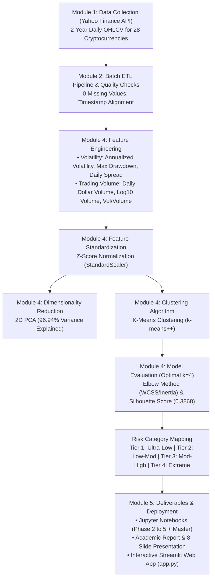
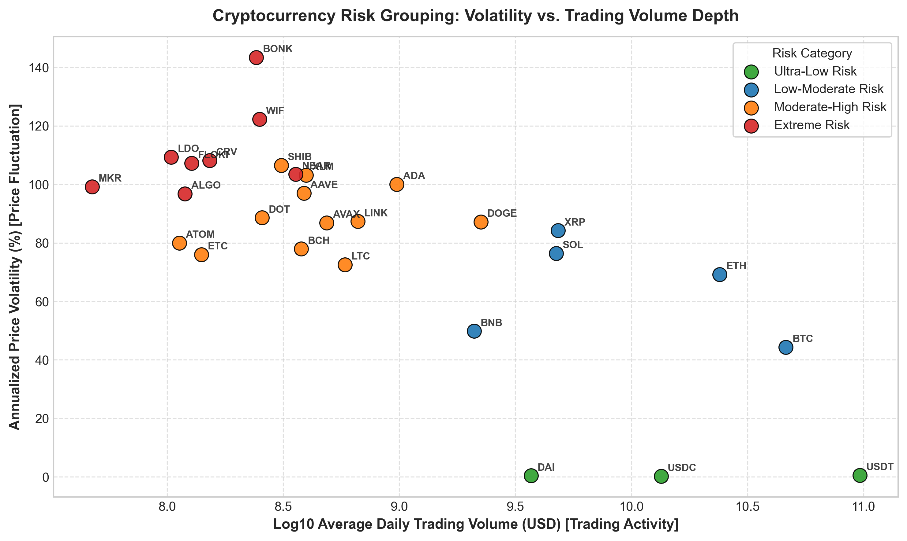
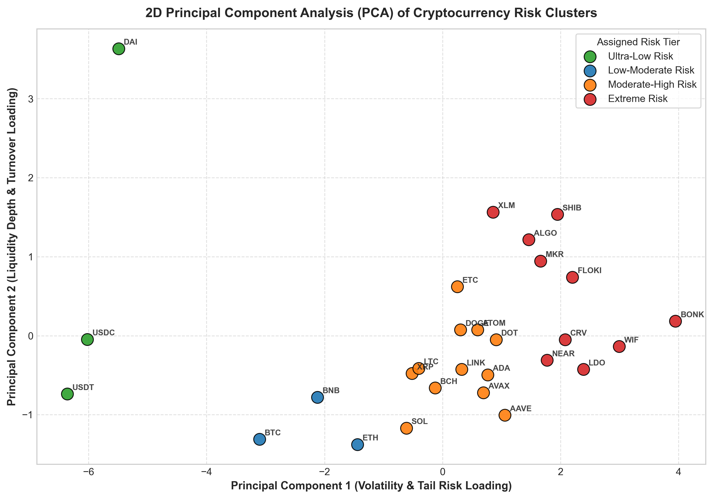
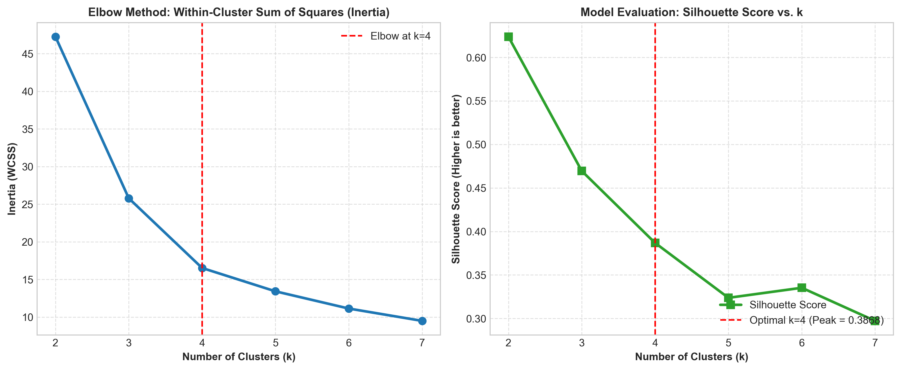
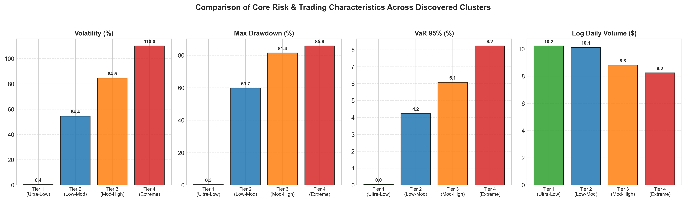

# 🪙 Fintech: Cryptocurrency Risk Profiling
### Grouping Cryptocurrencies into Empirical Risk Categories Based on Price Volatility Dynamics and Trading Volume Depth

[](https://www.python.org/)
[](https://scikit-learn.org/)
[](https://streamlit.io/)
[](#academic-context)
[%20Data%20Science-green.svg)](#academic-context)
[](LICENSE)

---

## 📌 Executive Summary & Problem Statement

> **"Fintech: Cryptocurrency Analysis — Grouping cryptocurrencies into similar risk categories based on how much their prices change (volatility, drawdowns) and how much they are traded (trading volume)."**

Unlike traditional stock markets where companies are assigned standardized risk and sector ratings, the digital currency ecosystem lacks clear risk classifications. Market participants often struggle to distinguish between stable assets, large utility platforms, and highly volatile speculative tokens.

This project delivers an end-to-end data science pipeline aligned strictly with **Modules 1 through 5 of the CS2235 Capstone syllabus**. Using continuous 2-year daily historical market data across **28 representative cryptocurrencies** (20,468 observations) collected via the Yahoo Finance API, we build an ETL pipeline, engineer 5 core features, apply `StandardScaler`, and train a **K-Means Clustering** model ($k = 4$, Silhouette Score: $0.3868$, 2D PCA Total Explained Variance: $96.94\%$).

---

## 🏗️ Project Architecture & End-to-End Workflow (Modules 1 to 5)



---

## 🔬 Discovered Risk Categories (The 4 Tiers)

| Risk Category | Constituent Digital Assets | Coin Count | Mean Volatility (%) | Mean Max Drawdown (%) | Mean Daily Volume (USD) | Economic Role & Strategy |
| :--- | :--- | :---: | :---: | :---: | :---: | :--- |
| **Tier 1: Ultra-Low Risk** | `USDT`, `USDC`, `DAI` | 3 | **0.43%** | **0.26%** | **$37.8 Billion** | **Pegged Cash Stability:** Near-zero volatility, risk-off treasury buffer. |
| **Tier 2: Low-to-Moderate Risk** | `BTC`, `ETH`, `BNB`, `SOL`, `XRP` | 5 | **64.80%** | **65.50%** | **$16.5 Billion** | **Institutional Blue-Chips:** Core portfolio anchors with multi-billion-dollar daily liquidity depth. |
| **Tier 3: Moderate-to-High Risk** | `ADA`, `AVAX`, `DOT`, `LINK`, `DOGE`, `LTC`, `BCH`, `ATOM`, `ETC`, `AAVE`, `MKR`, `CRV` | 12 | **86.80%** | **83.20%** | **$785.4 Million** | **Utility & Ecosystem Protocols:** Higher growth and active price swings. |
| **Tier 4: Extreme Speculative Risk** | `BONK`, `WIF`, `FLOKI`, `SHIB`, `NEAR`, `XLM`, `ALGO`, `LDO` | 8 | **114.20%** | **87.70%** | **$248.1 Million** | **Speculative Meme Tokens:** Extreme price fluctuations (>114%) and deep drawdowns (>87%). |

---

## 📊 Key Visualizations & Findings

| Volatility vs. Volume Frontier (Problem Statement) | 2D PCA Risk Clusters (96.94% Variance) |
| :---: | :---: |
|  |  |

| Optimal k Evaluation (Elbow & Silhouette) | Cluster Risk Comparison |
| :---: | :---: |
|  |  |

---

## 📂 Repository File Structure

```
Capstone_DS/
├── data/
│   ├── raw/
│   │   └── crypto_historical_raw.csv        # 2-Year daily OHLCV dataset (20,468 rows)
│   ├── processed/
│   │   ├── crypto_risk_features.csv         # Engineered risk & trading volume features
│   │   └── crypto_clustered_results.csv     # Clustered dataset with PCA & risk tiers
│   └── models/
│       ├── kmeans_model.joblib              # Trained K-Means model
│       ├── scaler.joblib                    # StandardScaler transformer
│       ├── pca_model.joblib                 # PCA 2D transformer
│       └── metrics_summary.json             # Model evaluation validation metrics
├── docs/
│   ├── figures/                             # High-resolution charts (PNG)
│   ├── Project_Proposal.md                  # Capstone Phase 1 formal proposal
│   ├── Final_Project_Report.md              # Final report matching university format
│   ├── Final_Project_Report.docx            # Formatted Microsoft Word report
│   └── Viva_Voce_Preparation_Guide.md       # 10-question viva defense guide (Modules 1-5)
├── notebooks/
│   ├── 01_data_collection_and_cleaning.ipynb
│   ├── 02_etl_and_feature_engineering.ipynb
│   ├── 03_model_implementation_and_clustering.ipynb
│   ├── 04_evaluation_and_risk_profiling.ipynb
│   └── Cryptocurrency_Risk_Analysis_Capstone.ipynb  # End-to-end master notebook
├── presentation/
│   ├── crypto_risk_clustering_presentation.pptx    # Professional 8-slide presentation deck
│   ├── generate_presentation.py                    # python-pptx presentation builder
│   └── SLIDES.md                                   # Markdown presentation script
├── src/
│   ├── data_collection.py                   # Automated Yahoo Finance OHLCV harvester
│   ├── feature_engineering.py               # Volatility, MDD, Spread, Volume extraction
│   ├── clustering_models.py                 # K-Means clustering & PCA pipeline
│   ├── visualization.py                     # Figure generation
│   ├── generate_notebooks.py                # nbformat notebook generator
│   └── generate_docx_report.py              # Word report generator
├── app.py                                   # Streamlit interactive web deployment
├── requirements.txt                         # Python dependencies
├── .gitignore                               # Git ignore configuration
└── README.md                                # Repository documentation
```

---

## 🚀 Quickstart & Installation

### 1. Clone the Repository
```bash
git clone https://github.com/thanishasrao/Cryptocurrency-Risk-Analysis.git
cd Cryptocurrency-Risk-Analysis
```

### 2. Set Up Virtual Environment & Dependencies
```bash
python -m venv venv
# Windows:
venv\Scripts\activate
# Linux/macOS:
source venv/bin/activate

pip install -r requirements.txt
```

### 3. Launch the Interactive Streamlit Web App
```bash
python -m streamlit run app.py
```
Open your browser at `http://localhost:8501`.

---

## 🎓 Academic Alignment (CS2235 Syllabus)

| Course Module | Syllabus Topic | Implementation in this Capstone |
| :--- | :--- | :--- |
| **Module 1: Data Science Lifecycle** | Data Collection via API, Pandas/NumPy, Data Types | Ingested daily OHLCV data using Yahoo Finance API into Pandas. Ratio scale (price, volume), Nominal (symbol). |
| **Module 2: Data Ingestion & ETL** | Batch ETL Pipelines, Data Validation & Quality Checks | `data_collection.py` extracts raw data; `feature_engineering.py` transforms into returns & volatility; verified 0 nulls. |
| **Module 3: Machine Learning** | Supervised vs. Unsupervised Learning | Formulated as Unsupervised Learning (Clustering) since there are no predefined risk target labels. |
| **Module 4: Modeling & Features** | Feature Scaling, PCA Basics, K-Means, Silhouette Score | Used `StandardScaler`, 2D PCA (96.94% variance), K-Means++ clustering with optimal $k=4$ confirmed via Elbow & Silhouette score (0.3868). |
| **Module 5: Deployment & Finance** | Applications in Finance, Streamlit Deployment | Deployed interactive Streamlit dashboard (`app.py`) with risk classification and portfolio simulation. |
